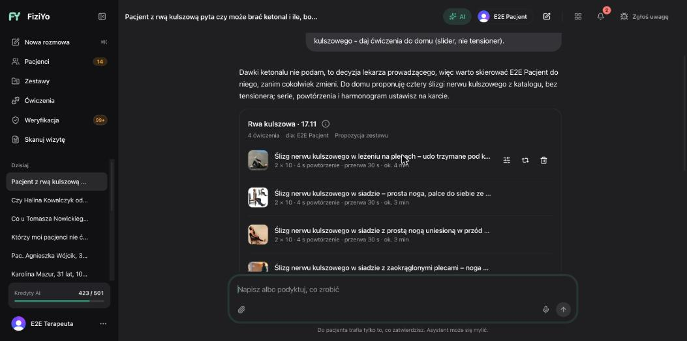
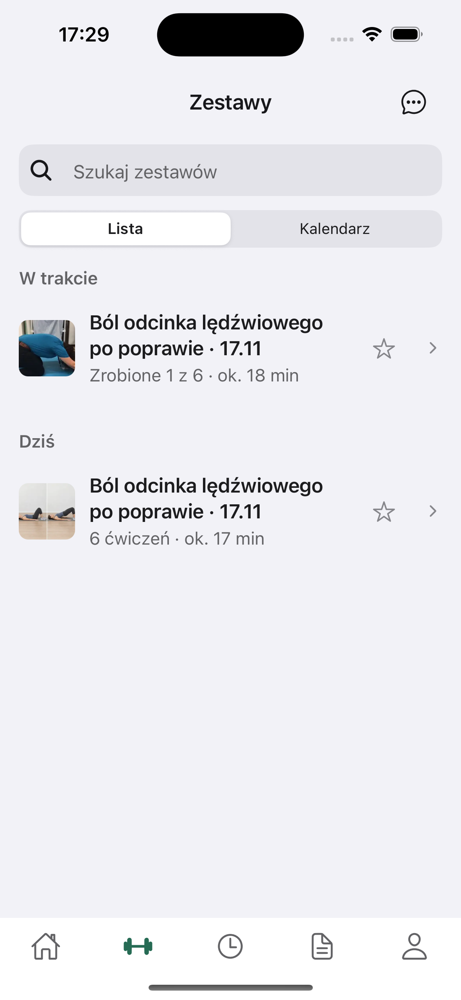
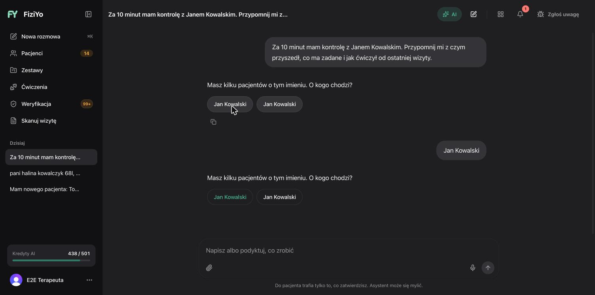
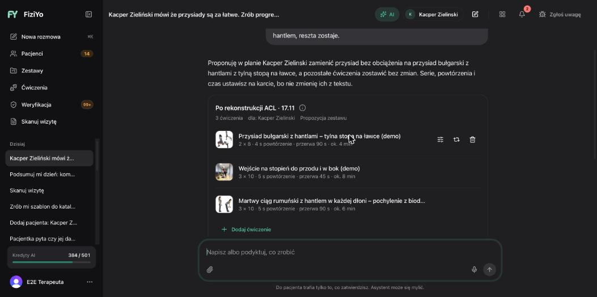
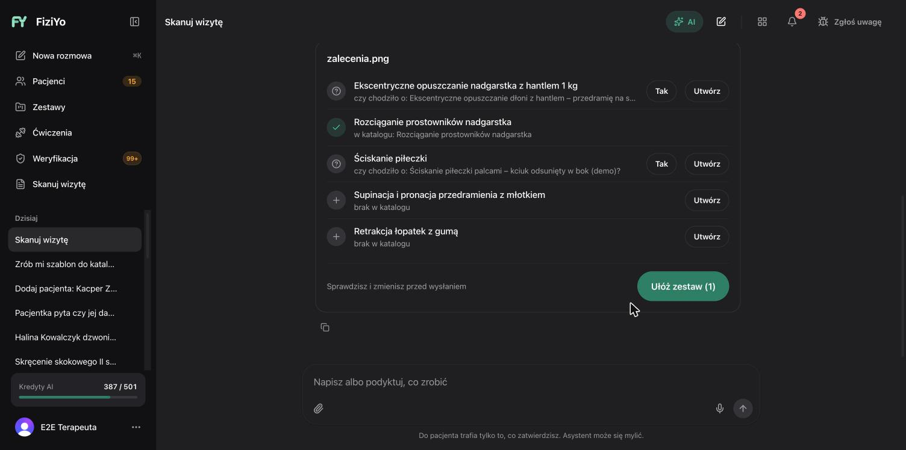

# Asystent AI w portalu FiziYo – test eksploracyjny z personami

**Data:** 17.11.2026 · **Środowisko:** DEV (devportal.fiziyo.pl, konto „E2E Terapeuta”, 5266 ćwiczeń) · **Aplikacja pacjenta:** build Preview na osobnym symulatorze „FiziYo AI-TEST iPhone-16” (łączy się z DEV)

Przebieg: 24 scenariusze w dwóch turach, ok. 70 wiadomości do asystenta (63 kredyty: 447 → 384), 4 nowych pacjentów, 2 konta pacjentów w aplikacji z prawdziwymi treningami. Pełny dziennik z numerami P01–P97: [SCENARIUSZE.md](SCENARIUSZE.md). W repo są tylko zrzuty osadzone niżej (katalog [zrzuty/](zrzuty/)); numery w nawiasach kwadratowych odpowiadają numerom pozostałych z 95 zrzutów z testu, które zostały poza repo.

**Wyniki drugiej tury są w rozdziale 9** – dochodzą tam 3 nowe błędy krytyczne i dwie korekty do tury pierwszej.

---

## 1. Werdykt w trzech zdaniach

Asystent jest **dobry w myśleniu klinicznym**: rozumie żargon, uzasadnia dobór, rozpoznaje czerwone flagi, odmawia dawek leków i obietnic.
Jest **słaby w domykaniu pracy**: nie zmienia dawek, nie edytuje istniejącego planu (tworzy drugi), nie zapisuje notatki, nie pisze do pacjenta i nie widzi, jak pacjent ćwiczył.
Ma też **cztery błędy, które mogą skończyć się wysłaniem planu nie tej osobie albo zostawieniem pacjentowi bolesnego ćwiczenia** – te trzeba naprawić przed pokazaniem komukolwiek.

---

## 2. Persony

**Fizjoterapeutka – Marta, 34 lata.** Prywatny gabinet, ortopedia i sport, ok. 35 wizyt w tygodniu. ChatGPT zna „do maili i przepisów”. Po godzinie z FiziYo. Pisze tak, jak mówi: jedno długie zdanie z kilkoma prośbami, czasem bez polskich znaków, czasem skrótami z karty.

| Pacjent                                         | Typ                                                                           | Co testował                                                   |
| ----------------------------------------------- | ----------------------------------------------------------------------------- | ------------------------------------------------------------- |
| Tomasz Nowicki, 42, programista                 | ból krzyża od siedzenia                                                       | pierwsza wizyta, kontrola, konto w aplikacji, trening z bólem |
| Halina Kowalczyk, 68                            | 6 tyg. po endoprotezie biodra, bez smartfona                                  | bezpieczeństwo doboru, wydruk, pacjent bez konta              |
| Jan Kowalski (istniejący, dwóch o tym nazwisku) | zgłosił ból 5/5, nie ćwiczy od 8 dni                                          | wizyta kontrolna, imiennicy                                   |
| Kacper Zieliński, 27, piłkarz                   | 8 tyg. po rekonstrukcji ACL                                                   | sportowiec, pytanie o powrót do biegu                         |
| Karolina Mazur, 31                              | 10 tyg. po porodzie, rozejście kresy                                          | uroginekologia, 10 minut dziennie                             |
| Agnieszka Wójcik, 38, księgowa                  | konflikt podbarkowy                                                           | zapis czysto branżowy (Neer, Hawkins, GIRD)                   |
| bez nazwisk                                     | ogon koński, rwa + leki, ciąża z PGP, skolioza u 9-latka, pacjentka z Ukrainy | pytania, których się nie spodziewamy                          |

---

## 3. Błędy krytyczne (do naprawy w pierwszej kolejności)

### K1. Plan podpinany pod niewłaściwego pacjenta

- Wiadomość zaczynała się od „**Pacjent** z rwą kulszową…” → asystent związał rozmowę z pacjentem o nazwisku „E2E **Pacjent**” i od razu dał „Dalej: harmonogram”. [58]
- „Nowa pacjentka Oksana Shevchenko… skopiuj jej zestaw Haliny” → karta „Po endoprotezie biodra · **dla: Tomas Nowi**” – pacjent z bólem krzyża, niewymieniony w rozmowie. [62]

**Co zrobić:** pacjent wchodzi do rozmowy tylko przez jawne dopasowanie pełnego imienia i nazwiska albo wybór z listy; przy każdym innym dopasowaniu pytanie „Czy chodzi o…?”. Nazwisko pacjenta dużą czcionką na karcie „Gotowe do wysłania”.

### K2. „Zmień plan” tworzy drugi plan zamiast poprawić istniejący

- „Wyrzuć kobrę z jego planu” → nowy plan, stary (z kobrą, która nasila ból) zostaje aktywny. [34]
- Po zamianie bolesnego ćwiczenia pacjent widzi w telefonie **dwa zestawy o identycznej nazwie**, stary nadal „W trakcie”. [66]
- Każda „zmiana” zeruje harmonogram do „2 tygodnie od jutra”. [65]
- Asystent sam nie umie usunąć ani wyłączyć planu („nie mogę usuwać planów z czatu”). [35]

**Co zrobić:** gdy pacjent ma aktywny plan, domyślną akcją jest „Zastąp obecny plan” (z zachowaniem dat i postępu) i jedno pytanie „zastąpić czy dodać obok?”.

### K3. Imiennicy – pętla bez wyjścia

Dwóch „Jan Kowalski” → dwa identyczne chipy, kliknięcie dowolnego wraca do tego samego pytania. Dopisek „ten z Premium, który zgłosił ból” nie pomaga. [24–26]

**Co zrobić:** chip niesie identyfikator pacjenta, nie tekst; na chipie wyróżnik (powód wizyty, ostatni trening, końcówka e-maila).

### K4. Asystent nie widzi, jak pacjent ćwiczył

Tomasz zrobił trening i zgłosił ból 4/5 z komentarzem „ciągnie mnie w pośladku i drętwieje łydka. Czy mam to dalej robić?”.

- „Co u Tomasza? Ćwiczył? Zgłaszał coś?” → „Otwieram: Pacjenci”. [49]
- „Pokaż, jak ćwiczył i czy zgłaszał ból” → „Ci pacjenci ostatnio nie ćwiczą, możesz im przypomnieć”. [50]
- „Przy którym ćwiczeniu, co napisał?” → „Nie mam w danych treści zgłoszenia”. [52]
- Panel „Kontekst”: „Ten tydzień: brak planu”, jako zestaw pokazany stary plan. [53]
- Karta pacjenta nad zgłoszeniem drętwienia pokazuje „STATUS W NORMIE… utrzymaj pozytywny feedback”. [54]

Gdy to samo zgłoszenie przepisałem ręcznie, odpowiedź była bardzo dobra (zamiana ćwiczenia + „sprawdź neurodynamikę, czucie, odruchy”). [64] **Brakuje danych, nie rozumu.**

**Co zrobić:** dać asystentowi wykonania, ból, trudność i komentarze per ćwiczenie; pytanie „co u X?” ma zwracać gotową odprawę przed wizytą; komentarz z objawem neurologicznym oznaczać jako pilny; powiadomienie „Ból 4/5” pokazywać z ćwiczeniem, treścią i przyciskiem „Zmień ćwiczenie”.

### K5. „Wysłane. Pacjent zobaczy plan w aplikacji” – a pacjent nie ma konta

Tomasz i Halina mieli status „Bez konta”, żaden e-mail nie wyszedł. Asystent nie zna statusu zaproszenia [12], na „czy odebrała zestaw?” odpowiada „status przypisany… mogę przypomnieć” [55], a dla pacjentki bez smartfona nie wie o istniejącym „Drukuj Kartę / Pobierz PDF” [23].

**Co zrobić:** po wysłaniu pokazać stan faktyczny i następny krok: „Pacjent nie ma jeszcze konta → Kod QR / wyślij link / wydrukuj kartę”.

### K6. Rejestracja pacjenta nadpisuje dane w kartotece fizjo

Fizjo wpisał „Kacper Zieliński”, pacjent przy zakładaniu konta „Zielinski” → w portalu jest teraz „Kacper Zielinski” (lista, powiadomienia, rozmowy). [94] To samo spotkało Tomasza: w portalu „Tomasz Nowicki” zmienił się w „Tomas Nowi” – tam skrócenie wynikało z gubienia znaków przez symulator, ale skutek pokazuje ryzyko: asystent przestał go znajdować po właściwym nazwisku i nie powiedział „nie znalazłem”. [51, 54]

**Co zrobić:** dane wpisane przez fizjo mają pierwszeństwo; w aplikacji podpowiedzieć je pacjentowi zamiast pytać drugi raz.

### K7. Odpowiedź tekstem na pytanie o harmonogram kasuje postęp

„Pon–pt, weekendy wolne, 2 tygodnie” wpisane zamiast kliknięcia chipa → asystent ułożył zestaw od nowa, zgubił wybranego pacjenta, pobrał kredyt. [08, 09]

---

## 4. Problemy ważne

| #   | Problem                                                                                                                                                                                                                                                  | Dowód            |
| --- | -------------------------------------------------------------------------------------------------------------------------------------------------------------------------------------------------------------------------------------------------------- | ---------------- |
| W1  | **Dawki i uwagi tylko ręcznie.** „Mostki 3×8”, „przerwa 90 s”, „dopisz uwagę: nie krzyżuj nóg” → „nie zmienię z tekstu”. Odsyła do „pola dla pacjentki na karcie”, którego w karcie czatu nie ma.                                                        | [19, 21, 56]     |
| W2  | **Brak notatki z wizyty i wiadomości do pacjenta.** Ból 6→3/10, ROM, blizna – nigdzie się nie zapisują; asystent tego nie proponuje.                                                                                                                     | [57]             |
| W3  | **Ograniczenia z prośby ignorowane.** „Max 10 minut” → 20, po upomnieniu 16; „bez sprzętu” → wałek; „przedłuż do 4 tygodni” → 2 tygodnie; „ok. 10 minut” w tekście przy 13 na karcie.                                                                    | [04, 05, 32, 39] |
| W4  | **Prośba złożona rozpada się.** „Dodaj pacjenta i ułóż zestaw” → formularz, potem „Na jaki problem?” z pustym zestawem.                                                                                                                                  | [01–03]          |
| W5  | **Niespójne zachowanie.** Raz formułka „Proponuję te ćwiczenia z katalogu”, raz pełne uzasadnienie; raz proponuje dodanie pacjenta, raz nie; formularz raz wypełniony, raz pusty; rodzaj męski i żeński na zmianę; trzy różne układy karty.              | [04, 16, 22, 59] |
| W6  | **„Skanuj wizytę” nie znajduje ćwiczeń, które katalog ma.** 3 z 5 „brak w katalogu” (izometria czworogłowego, SLR, mini przysiad); gubi dawki i przeciwwskazania z notatki.                                                                              | [68]             |
| W7  | **Dobór bywa nietrafiony przy mocnym opisie.** „Żaba” (rotacja) po endoprotezie wbrew własnemu uzasadnieniu; chód z gumą dla osoby o kuli; zestaw „seniorski” dla piłkarza po ACL; „z naciskiem na zabawę” dla 9-latka = deska boczna; Y-T-W → samo „W”. | [16, 37, 60, 40] |
| W8  | **Pytanie zbiorcze o pacjentów.** „Kto zgłaszał ból, komu kończy się plan?” → „nie widzę zbiorczo”, lista 14 osób z pacjentami bez konta i przycisk „Przypomnij wszystkim” bez podglądu.                                                                 | [41]             |
| W9  | **Zamiennik z ikony:** „Brak podobnych ćwiczeń w katalogu” przy 5266 ćwiczeniach.                                                                                                                                                                        | [17]             |
| W10 | **Tryb „Bez AI”:** całe zdanie jako słowa kluczowe → „brak ćwiczeń”.                                                                                                                                                                                     | [69]             |
| W11 | **Czas zestawu liczony niespójnie** (ten sam zestaw 16 i 21 min); „Masz 2 minuty?” przy 18 min w aplikacji.                                                                                                                                              | [56, 42]         |
| W12 | **Kredyty schodzą za odmowy i pętle**, a asystent „nie ma informacji o kosztach”.                                                                                                                                                                        | [61]             |

Drobniejsze (pełna lista w notatkach): nazwa zestawu = ucięty opis kliniczny widoczny dla pacjenta, „(demo)” w nazwach, chipy „Doprecyzuj” pytają o rzeczy już podane, brak odmiany nazwisk („u Halina Kowalczyk”), lista pacjentów w czacie bez wyszukiwarki, licznik 14 vs 15, „Trudność 2/5” bez legendy, tytuł karty „FiziYo Admin”, link pacjenta z DEV na domenę fiziyo.pl, zgoda na dane o zdrowiu dopiero po wpisaniu bólu.

---

## 5. Co działa dobrze (warto chronić)

1. **Czerwone flagi.** Drętwienie krocza + zatrzymanie moczu + słabnąca stopa → odmowa zestawu, „zespół ogona końskiego, pilnie SOR”. [36]
2. **Uzasadnienie doboru.** Endoproteza z dojścia tylnego: co pominął i dlaczego, pytanie o gumę. [16]
3. **Poprawki rozmową.** „Żaba odpada, daj napinanie czworogłowego, odwodzenie przy blacie, wstawanie z krzesła” – wykonane, reszta nietknięta. [18]
4. **Żargon.** Sleeper stretch, cross-body, serratus punch, wall slides, slider vs tensioner – trafione. [40, 58]
5. **Granice.** Bez dawek leków, bez „gwarancji w 3 wizyty”, uczciwe „katalog nie ma ćwiczeń PGP w ciąży”. [58, 59, 63]
6. **Wiedza.** Kryteria powrotu do biegu po ACL – zwięzłe i poprawne. [38]
7. **Kontrola.** Odczytał aktualny plan pacjenta i zmienił go zgodnie z prośbą. [31]
8. **Karta „Gotowe do wysłania”** i parametry w wierszu ćwiczenia – czytelne. [10, 20]
9. **Aplikacja pacjenta:** konto łączy się z gabinetem po samym e-mailu, zmiany docierają w kilkanaście sekund, zgłoszenie bólu z komentarzem jest proste.
10. **„Skanuj wizytę”** bezbłędnie rozszyfrowuje skróty z karty. [68]

---

## 6. Proponowana kolejność prac

1. **Bezpieczeństwo przypisania:** K1, K3, K6 (kto dostaje plan).
2. **Jeden plan, edytowany w miejscu:** K2 + W1 (dawki i uwagi z tekstu) + K7.
3. **Asystent widzi trening pacjenta:** K4 – największy skok przydatności; od tego zależy odprawa przed wizytą i reakcja na ból.
4. **Prawda o dostarczeniu:** K5 (konto, QR, wydruk).
5. **Domknięcie wizyty:** notatka kliniczna i wiadomość do pacjenta z rozmowy (W2).
6. **Jakość doboru:** ograniczenia jako twarde warunki (W3), wspólna wyszukiwarka dla czatu, zamiennika i skanu (W6, W9), profil pacjenta (wiek, sport, sprzęt) w doborze (W7).
7. **Spójność:** jeden wzorzec odpowiedzi, jedna osoba gramatyczna, odmiana nazwisk (W5).

---

## 7. Stan po teście (DEV)

- Nowi pacjenci w org „FiziYo E2E DEV”: Tomasz Nowicki (obecnie „Tomas Nowi”, konto w aplikacji, 2 aktywne plany o tej samej nazwie), Halina Kowalczyk (bez konta, 1 plan).
- Usunięte: 1 przypisanie planu Tomasza (stary plan z kobrą) – świadomie, w ramach scenariusza.
- Nie ruszałem: Jan Kowalski, E2E Pacjent, powiadomień „Przejrzane”, przycisku „Przypomnij wszystkim”.
- Symulator „FiziYo AI-TEST iPhone-16” (DFDDAFE1-…) działa, zalogowany jako Tomasz; pozostałe 7 symulatorów nietknięte.
- Tryb AI w portalu przywrócony do włączonego.

## 8. Czego nie sprawdziłem

Dyktowanie głosem, „Przypomnij” (wysyłka), Android, zapis nowego ćwiczenia do katalogu, zdjęcie odręcznej notatki (testowałem obraz z tekstem drukowanym). Jeden raz Enter nie wysłał wiadomości z ekranu startowego – możliwy artefakt automatu, do powtórzenia ręcznie.

---

## 9. Druga tura (scenariusze 15–24)

Nowe persony i sytuacje: fizjo nietechniczny („dla tej pani co wczoraj była, po biodrze”), neurologia (udar), plan fazowy dla siatkarki, przegląd bezpieczeństwa zestawu, pytanie o RODO, prośba po angielsku, szablon do katalogu, tworzenie własnego ćwiczenia, skan obrazu, podsumowanie dnia, drugi pacjent z kontem i pełnym treningiem.

### Nowe błędy krytyczne

**K8. „Reszta zostaje” – a ćwiczenie znika.** „Zamień przysiad na bułgarski, reszta zostaje” → asystent pisze „pozostałe ćwiczenia zostawić bez zmian”, a karta ma 3 ćwiczenia zamiast 4 (mostek jednonóż zniknął). [95]

**K9. Skan zaleceń podsuwa przeciwną grupę mięśni.** Karta „łokieć tenisisty – ekscentryczne opuszczanie nadgarstka” → „czy chodziło o: …dłonią do góry (zginacze nadgarstka)?”. Jedno „Tak” i pacjent dostaje ćwiczenie na łokieć golfisty. [85]

**K10. Komentarz pacjenta przepada po odmowie zgody (aplikacja).** Kacper ocenił ćwiczenie jako łatwe i napisał „kolano po treningu lekko puchnie”, bez oceny bólu. Wyskoczyła zgoda na dane o zdrowiu; po „Anuluj” aplikacja przeszła dalej bez komunikatu, a fizjo nie dostał ani komentarza, ani oceny trudności. [92, 94]

**Potwierdzenia z pierwszej tury:** K6 (nadpisanie nazwiska) odtworzone na czysto; K7 (harmonogram tekstem kasuje postęp) odtworzone drugi raz [82].

### Nowe problemy ważne

| #   | Problem                                                                                                                                                                                                                                                                                                                                               | Dowód        |
| --- | ----------------------------------------------------------------------------------------------------------------------------------------------------------------------------------------------------------------------------------------------------------------------------------------------------------------------------------------------------- | ------------ |
| W13 | **Tworzenie ćwiczenia gubi opis fizjo.** Z „opadanie pięty z plecakiem 5 kg, 3 s w dół, 3×15 2× dziennie, ból do 4/10 dopuszczalny” do karty trafia sama nazwa; wygenerowano 3×12 „naprzemiennie” i „przerwij przy ostrym bólu”. Grafika: mężczyzna z plecakiem pcha ścianę. Kroki za długie do playera (140/120) – AI samo je pisze i samo ostrzega. | [71–73]      |
| W14 | **Ukryty koszt:** „Generuj” ćwiczenia zużyło 9 kredytów, rozmowa pokazuje „−1 kredyt AI”.                                                                                                                                                                                                                                                             | [71]         |
| W15 | **Zmyślone wskazówki do interfejsu.** „Automatyczne przechodzenie faz ustawisz na karcie”, „kryteria wpisz do notatek planu” – takich pól nie ma. Z planu 4-fazowego powstała tylko faza 1, kryteriów nie wypisał.                                                                                                                                    | [77]         |
| W16 | **Pytanie staje się nazwą ćwiczenia.** „Które ćwiczenia są najczęściej przerywane?” → przycisk „Utwórz ćwiczenie: w moim katalogu są najczęściej przerywane albo zgłaszane jako bolesne?…”.                                                                                                                                                           | [88]         |
| W17 | **Asystent nie pamięta własnego dnia.** „Komu dziś wysłałam zestawy, kogo dodałam?” → „nie widzę dziennika wysyłek” + lista „Przypomnij”.                                                                                                                                                                                                             | [87]         |
| W18 | **Brak cofnięcia wysyłki** („nie mam takiej funkcji… napisz do niego” – pisać też nie można).                                                                                                                                                                                                                                                         | [75]         |
| W19 | **Pacjenta nie da się wskazać opisowo** („pani po biodrze z wczoraj” – jest jedna taka).                                                                                                                                                                                                                                                              | [74]         |
| W20 | **Nazwa i limit czasu z prośby nie trafiają do karty.** „Biurowy kark – 5 minut” → „Nowy zestaw · 17.11”, 12 minut; „Pełny edytor” otwiera się z pustą nazwą.                                                                                                                                                                                         | [83, 84]     |
| W21 | **Wiedza z rozmowy znika.** Po przeglądzie „osteoporoza, złamanie Th12, rozrusznik” asystent nie proponuje ani zmiany zestawu, ani zapisania chorób w karcie.                                                                                                                                                                                         | [78]         |
| W22 | **RODO:** na „czy dane o zdrowiu idą do AI za granicą?” – „nie widzę, sprawdź w polityce prywatności”. Potrzebna gotowa, zatwierdzona odpowiedź.                                                                                                                                                                                                      | [79]         |
| W23 | **Język:** prośba po angielsku → odpowiedź po polsku; o tłumaczeniu ćwiczeń raz „karta nie tłumaczy”, raz „nie mam informacji”.                                                                                                                                                                                                                       | [80]         |
| W24 | **Aplikacja:** przerwane ćwiczenie nie zostawia śladu („postęp nie zostanie zapisany”), skala bólu bez „nie bolało”, „Masz 4 minuty?” to czas pierwszego ćwiczenia, nie zestawu.                                                                                                                                                                      | [93, 92, 89] |
| W25 | **Dobór kliniczny (kolejne przykłady):** inwersja z taśmą w 5. dobie po skręceniu bocznym; 27 minut i guma na palce przy spastyczności po udarze; gonartroza bez wzmacniania czworogłowego.                                                                                                                                                           | [77, 76, 80] |

### Co wypadło dobrze

- **Dodanie pacjenta z jednego zdania** – imię, nazwisko, telefon, e-mail i powód rozpoznane bezbłędnie. [81]
- **Przegląd zestawu pod choroby współistniejące** – rzeczowy, ćwiczenie po ćwiczeniu, z uczciwym zastrzeżeniem. [78]
- **Samo „kolano”** → dobre dopytanie z czterema chipami. [74]
- **Wyszukiwanie ćwiczeń** (Alfredson, rozcięgno) i pytanie „układamy zestaw czy przeglądamy?”. [70]
- **Skan obrazu** odczytał cały dokument i **przeniósł dawki** (korekta do W6 z pierwszej tury: dawki giną tylko przy pozycjach „brak w katalogu”). [85, 86]
- **Player w aplikacji** – pełne ćwiczenie przeszło płynnie, czas 4:06 przy zalecanym 4:05, wynik trafił do karty fizjo w kilka sekund. [90, 91]
- **Dopasowanie nazwiska bez znaków diakrytycznych** („Zieliński” → „Zielinski”) działa.

### Korekty do pierwszej tury

- K6: przykład „Tomas Nowi” był skutkiem gubienia znaków przez symulator, nie literówki pacjenta. Mechanizm nadpisywania jest jednak prawdziwy – potwierdzony na Kacprze.
- W6: „Skanuj wizytę” przenosi serie i powtórzenia dla ćwiczeń znalezionych w katalogu.

### Zaktualizowana kolejność prac

Do listy z rozdziału 6 dochodzą: **K8 przed wszystkim innym w punkcie 2** (edycja planu nie może gubić ćwiczeń, a opis zmian musi zgadzać się z kartą), **K9 w punkcie 6** (skan: przy niepewnym dopasowaniu pokazać mięsień/cel i nie proponować ćwiczenia sprzecznego z rozpoznaniem z dokumentu), **K10 po stronie aplikacji** (komentarz bez oceny bólu nie powinien wymagać zgody albo aplikacja musi powiedzieć, że nic nie wysłała).

### Stan po drugiej turze (DEV)

- Doszedł pacjent Kacper Zieliński (w portalu „Kacper Zielinski”, konto w aplikacji, 1 plan, 1 wykonane ćwiczenie).
- Symulator AI-TEST zalogowany jako Kacper (aplikacja była reinstalowana – sesja Tomasza wylogowana).
- Nie zapisałem do katalogu: nowego ćwiczenia „Opadanie pięty…”, szablonu „Biurowy kark”, zestawów ze skanu ani progresji Kacpra.
- Na koncie testowym Kacpra odmówiłem w aplikacji zgody na dane o zdrowiu (celowo, scenariusz 23).
