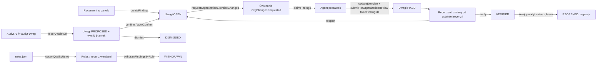
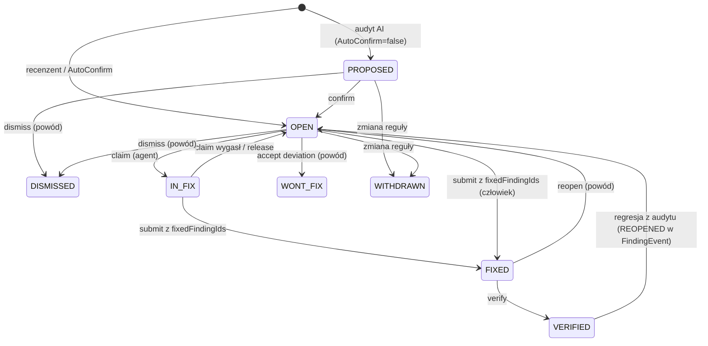

# Weryfikacja organizacji: uwagi, przebiegi audytu i pętla poprawek AI

Status: `draft`. Rozszerza [SPEC-009](SPEC-009-2026-05-25-organization-exercise-verification.md) (weryfikacja organizacji). Etapy 1–5 nie zmieniają weryfikacji globalnej z [SPEC-030](SPEC-030-2026-10-26-verification-stages.md); etap 6 przenosi do niej ten sam model. Zmiany obejmują backend `fizjo-app` i panel.

## Cel biznesowy

Panel weryfikacji organizacji ma być jednym miejscem, w którym:

1. uwagi do ćwiczenia (człowieka i audytu AI) są zapisane jako dane z kodem reguły, miejscem i dowodem, a nie jako jeden komentarz,
2. AI pobiera potwierdzone uwagi, poprawia ćwiczenie i odsyła poprawkę powiązaną z konkretnymi uwagami,
3. recenzent sprawdza tylko to, co się zmieniło, i zamyka uwagi,
4. zostaje pełna historia: kto, co zgłosił, co poprawiono i kiedy, łącznie z regresjami.

Skąd ta potrzeba: audyt `fx-audyt-uwag` z 29–30.10.2026 (`fiziyo-research/youtube-video-kb/reports/audit-skill-2026-10-29/`) objął 90 ćwiczeń i 51 bramek. Dał 556 uwag (328 BLOCKER, 228 MINOR) w statycznym HTML-u o wadze 1,4 MB, poza portalem. Po zmianie zasady układu obrazu 30.10 trzeba było ręcznie wycofać 88 uwag. Każda kolejna partia wymaga przepisywania uwag do pola komentarza, a historia ginie.

### Luki w obecnym kodzie

| #   | Luka                                                                                                                                                                                                      | Miejsce                                                                                          |
| --- | --------------------------------------------------------------------------------------------------------------------------------------------------------------------------------------------------------- | ------------------------------------------------------------------------------------------------ |
| L1  | `OrgReviewNotes` to jedno pole tekstowe, nadpisywane przy każdym przejściu statusu i czyszczone przy ponownym zgłoszeniu. U oczekujących trzyma tekst importu                                             | `fizjo-app/backend/FizjoApp.Api/Types/ExerciseMutation.cs` (submit ~2994, request changes ~3146) |
| L2  | Mutacje weryfikacji organizacji nie zapisują `ExerciseHistory`. Zapisują ją tylko mutacje globalne admina (`AdminExerciseMutation.cs`) i prośba o aktualizację                                            | `ExerciseMutation.cs`, `Services/ExerciseHistoryService.cs`                                      |
| L3  | `ExerciseHistory.Diff` i `PreviousState` mają `[GraphQLIgnore]`. Panel nie odpytuje `exerciseHistory`                                                                                                     | `Models/ExerciseHistory.cs`, `src/graphql/queries/`                                              |
| L4  | Szybkie powody są w trybie organizacji ukryte. Dotyczą wideo i nazwy, a nie kodów O/T/PAR/V                                                                                                               | `src/features/verification/VerdictPanel.tsx` (`QUICK_REJECT_REASONS`)                            |
| L5  | Walidacja w edytorze sprawdza minimum znaków i limity zdjęć. Nie sprawdza 3–8 słów we wskazówkach (T04), nazwanej strony (T15), trybu strony (PAR4) ani trudności (PAR6), choć to reguły deterministyczne | `stages/LengthHint.tsx`, `utils/photoValidation.ts`                                              |
| L6  | Brak przypięcia uwagi do pola, wskazówki, fazy obrazu albo sekundy filmu. Brak dowodu w postaci wycinka lub klatki                                                                                        | —                                                                                                |
| L7  | Brak widoku zmian od ostatniej recenzji. `utils/changeSummary.ts` porównuje tylko w obrębie bieżącej sesji edycji                                                                                         | `utils/changeSummary.ts`                                                                         |
| L8  | Brak filtrów kolejki i statystyk po kodach reguł i statusie uwag                                                                                                                                          | `organization/verification/page.tsx`                                                             |

## Architektura

### Zasada podziału

- **Portal i backend** przechowują uwagi, przebiegi audytu, reguły i historię. Wymuszają statusy i uprawnienia oraz pokazują je recenzentowi.
- **Agenci AI** (skille `fx-audyt-uwag`, `exercise-images`, walidatory w `fiziyo-research`) działają poza portalem. Rozmawiają z nim tylko przez GraphQL jako zwykli członkowie organizacji z rolą Therapist. Nie mogą zatwierdzać.
- **Rejestr reguł** ma jedno źródło: plik `rules.json` w skillu `fx-audyt-uwag`. Synchronizuje się go do backendu, a tabelę w `SKILL.md` generuje się z tego pliku.

### Pętla pracy



### Model danych (backend, tylko dodawanie)

**`QualityRuleSet`**: `Id`, `Key` (np. `fiziyo-content`), `OrganizationId` (null = globalny), `Name`, `IsDefault`.

**`QualityRule`**: `Id`, `RuleSetId`, `Code` (O01…O26, T01…T15, PAR1…PAR6, V1…V4), `Version` (int), `Category` (`IMAGE|TEXT|PARAMETER|VIDEO|PROCESS`), `Title`, `Requirement` (pełna treść), `DefaultSeverity`, `CheckKind` (`MANUAL|DETERMINISTIC|AI`), `CheckKey` (np. `cue_word_count`, null dla MANUAL), `AutoConfirm` (bool; uwaga z deterministycznego sprawdzenia od razu jest OPEN), `Source` (np. „28.10 uwaga użytkownika; FR-002”), `IsActive`, `CreatedAt`, `SupersededAt`. Unikalność: `(RuleSetId, Code, Version)`.

**`ExerciseFinding`**:

| Pole                                                                    | Opis                                                                                                       |
| ----------------------------------------------------------------------- | ---------------------------------------------------------------------------------------------------------- |
| `Id`, `ExerciseId`, `OrganizationId`                                    | Zakres tenanta jak w SPEC-009                                                                              |
| `RuleCode`, `RuleVersion`                                               | Nullable: uwaga bez kodu jest dozwolona (organizacje bez rejestru)                                         |
| `Severity`                                                              | `BLOCKER \| MAJOR \| MINOR \| INFO`                                                                        |
| `Status`                                                                | Zob. maszyna stanów                                                                                        |
| `Title`, `Description`                                                  | „Co jest źle”: z raportu `co`                                                                              |
| `TargetKind`                                                            | `EXERCISE \| FIELD \| PARAMETER \| STEP \| CUE \| IMAGE \| VIDEO \| RELATION`                              |
| `TargetPath`                                                            | JSON Pointer na DTO ćwiczenia / enrichment v3, np. `/side`, `/enrichmentData/patient/cues/4`               |
| `TargetMediaId`, `TargetPhase`, `TargetTimestampMs`, `TargetRegion`     | Obraz/faza (`start`, `work`, `rest`), sekunda filmu, prostokąt `{x,y,w,h}` w 0–1                           |
| `Evidence`                                                              | Tekst dowodu (z raportu `dowod`) + `FindingAttachment[]` (wycinki, klatki; blob, max 2 MB, max 5 na uwagę) |
| `FixProposal`                                                           | Tekst (z raportu `naprawa`)                                                                                |
| `ProposedPatch`                                                         | Opcjonalny JSON Patch (RFC 6902) na pola tekstowe i parametry; nigdy na media                              |
| `Source`, `SourceDetail`                                                | `HUMAN \| AUDIT_RUN \| AUTOMATIC_CHECK \| PATIENT_REPORT`; szczegół, np. „niezależny exercise-auditor”     |
| `AuditRunId`, `ExternalKey`                                             | Klucz deduplikacji: `hash(exerciseId, ruleCode, targetPath, targetMediaId, targetPhase)`                   |
| `ClaimedById`, `ClaimedUntil`                                           | Blokada agenta poprawek (TTL 2 h)                                                                          |
| `FixedInHistoryId`                                                      | Wpis `ExerciseHistory` z poprawką                                                                          |
| `ResolutionNote`                                                        | Wymagana przy DISMISSED, WONT_FIX, WITHDRAWN, REOPENED                                                     |
| `CreatedById`, `CreatedAt`, `UpdatedAt`, `LastSeenInRunId`, `SeenCount` | Zgłaszający; ostatni przebieg audytu, który ją potwierdził                                                 |

**`FindingEvent`**: dziennik tylko do dopisywania: `FindingId`, `ActorId`, `ActorRole`, `FromStatus`, `ToStatus`, `Note`, `AuditRunId`, `CreatedAt`. Historii uwag nie edytujemy.

**`AuditRun`**: `Id`, `OrganizationId`, `ExternalRunId` (np. `audit-skill-2026-10-29`, unikalny w organizacji), `Tool` (`fx-audyt-uwag`), `ToolVersion`, `RuleSetId`, `RuleSetSnapshot` (JSON: kody i wersje), `StartedAt`, `FinishedAt`, `ScopeCount`, `Summary` (JSON), `ReportUrl` (opcjonalny link do HTML), `ImportedById`.

**`AuditGateResult`**: `AuditRunId`, `ExerciseId`, `RuleCode`, `RuleVersion`, `Status` (kanoniczny), `RawStatus` (oryginał), `Note`. Statusy kanoniczne i mapowanie wartości z raportu 29.10:

| Kanoniczny       | Wartości surowe z `AUDYT-SKILL.json`                                                                                         |
| ---------------- | ---------------------------------------------------------------------------------------------------------------------------- |
| `PASS`           | `PASS`, `PASS_AUTOMAT`, `PASS_POLE`, `PASS_TAGI`, `PASS_DANE`, `PASS_SUMA_KANONU`, `PASS_DLUGOSC`, `OCENIONO_BEZ_ZNALEZISKA` |
| `FAIL`           | `FAIL`, `MINOR` (bramka niespełniona z uwagą MINOR)                                                                          |
| `PARTIAL`        | `CZESCIOWO_SPRAWDZONE`                                                                                                       |
| `UNVERIFIED`     | `NIEZWERYFIKOWANE`                                                                                                           |
| `NEEDS_HUMAN`    | `DO_OCENY_UTRZYMANIA`, `BEZ_ZARZUTU_UKLADU_CZYTELNOSC_DO_POTWIERDZENIA`                                                      |
| `NOT_APPLICABLE` | `NIE_DOTYCZY`                                                                                                                |

Nieznana wartość surowa → `NEEDS_HUMAN` i ostrzeżenie w wyniku importu.

**`AuditExerciseResult`**: `AuditRunId`, `ExerciseId`, `Verdict` (`PASS|FAIL`), `MovementPattern` (z raportu `wzorzec_ruchu`), `Doubts` (lista z `watpliwosci`).

**Blokada zatwierdzenia** (zawsze, w każdej organizacji, bez flagi): `approveOrganizationExercise` i wariant masowy odrzucają ćwiczenie, które ma uwagę BLOCKER w statusie nieterminalnym (`PROPOSED`, `OPEN`, `IN_FIX`, `FIXED`). Komunikat błędu podaje kody i liczbę uwag. Ćwiczenia bez uwag działają jak dotąd.

**`User.IsAutomation`** (bool, domyślnie `false`): konto automatyzacji (agent AI). Ustawia je tylko SiteSuperAdmin. `IsCompanyAccount` się do tego nie nadaje, bo rozróżnia fizjoterapeutę i pacjenta. Konto automatyzacji jest członkiem organizacji z rolą Therapist.

**Retencja:** wpisy `ExerciseHistory`, `FindingEvent` i snapshoty `PreviousState` przechowujemy bezterminowo, bo to ślad jakości. Załączniki uwag w statusie terminalnym usuwa zadanie okresowe po 12 miesiącach od zamknięcia. Uwaga zostaje, a dowód tekstowy dostaje dopisek „załącznik usunięty <data>”.

**`ExerciseHistoryAction`**: dopisujemy `OrgSubmitted = 15`, `OrgApproved = 16`, `OrgChangesRequested = 17`, `OrgWithdrawn = 18`, `OrgArchived = 19`, `FindingsFixed = 20`. Każda mutacja z SPEC-009 zapisuje wpis z notatką i `PreviousState` (pełny snapshot DTO ćwiczenia z enrichment i listą mediów).

### Maszyna stanów uwagi



Statusy terminalne: `VERIFIED`, `DISMISSED`, `WONT_FIX`, `WITHDRAWN`. Przejścia liczy czysta funkcja `findingStateMachine.ts` w panelu (UI) i jej odpowiednik w backendzie (egzekwowanie). Obie mają te same wektory testowe.

### Import przebiegu audytu: idempotencja i regresje

`importAuditRun` przyjmuje paczki po maks. 10 ćwiczeń. Dla każdej uwagi liczy `ExternalKey`:

- brak uwagi o tym kluczu → nowa uwaga (`PROPOSED` albo `OPEN`, gdy reguła ma `AutoConfirm`),
- uwaga nieterminalna o tym kluczu → `SeenCount += 1`, `LastSeenInRunId`, dopisany dowód; bez duplikatu,
- uwaga `VERIFIED` o tym kluczu → `OPEN` z `FindingEvent` „regresja w przebiegu X”,
- `DISMISSED`, `WONT_FIX` → bez zmian, licznik `SeenCount` (sygnał do kalibracji reguły),
- uwaga nieterminalna, której przebieg nie zgłosił, a bramka ma `PASS` → flaga `NotSeenInLatestRun` do decyzji człowieka. Bez automatycznego zamykania.

Mapowanie raportu `fx-audyt-uwag` (`AUDYT-SKILL.json`): `uwagi[].kod` → `RuleCode`, `waga` → `Severity`, `gdzie` + `dowod` → `TargetPath` i `Evidence`, `co` → `Description`, `naprawa` → `FixProposal`, `origin` → `SourceDetail`, `review == "potwierdzone na danych"` → dla reguł `DETERMINISTIC` status `OPEN`, `checklist[]` → `AuditGateResult`, `watpliwosci` → `AuditExerciseResult.Doubts`. Konwerter: `fiziyo-research/.claude/skills/fx-audyt-uwag/scripts/to_portal_import.py`, który zapisuje `import.json` obok raportu. Wysyłka: `import_audit_run.py` (paczki, raport błędów per ćwiczenie).

### Pętla poprawek AI

1. Recenzent zaznacza w kolejce ćwiczenia z otwartymi uwagami i wybiera „Odeślij do poprawek”. Działa to masowo, jak archiwizacja z SPEC-009. `reviewNotes` jest generowane z listy otwartych uwag, gdy recenzent nic nie wpisał. Wymaganie niepustej notatki zostaje.
2. Agent: `findingsForFix(organizationId, statuses:[OPEN], severities)` → `claimFindings(ids)` → edycja istniejącymi mutacjami (`updateExercise`, wymiana obrazu) → `submitForOrganizationReview(exerciseId, fixedFindingIds, note)`.
3. Backend przy zgłoszeniu: zapisuje `ExerciseHistory(FindingsFixed)` ze snapshotem, ustawia uwagi `FIXED` z `FixedInHistoryId`, zwalnia blokady. Uwagi niewymienione zostają `OPEN` i są widoczne przy recenzji.
4. Agent nie może zmienić statusu uwagi na `VERIFIED`, `DISMISSED`, `WONT_FIX` ani `WITHDRAWN`. Nie może też zatwierdzić ćwiczenia: rola Therapist na to nie pozwala.

### Zmiany od ostatniej recenzji

`exerciseReviewDiff(exerciseId)` porównuje bieżący stan ze snapshotem `PreviousState` z ostatniego wpisu `OrgApproved` lub `OrgChangesRequested`. Zwraca listę `{path, before, after}` dla tekstu i parametrów oraz `{mediaId, change: ADDED|REMOVED|REPLACED, beforeUrl, afterUrl}` dla mediów. Recenzent widzi baner „Zmieniono N pól od recenzji z <data>”, zmienione pola są podświetlone, a przy wymienionym obrazie jest przełącznik przed/po.

### Rejestr reguł

`fiziyo-research/.claude/skills/fx-audyt-uwag/rules.json` (źródło):

```json
{
  "ruleSet": "fiziyo-content",
  "rules": [
    {
      "code": "T04",
      "version": 2,
      "category": "TEXT",
      "title": "Wskazówki 3–8 słów",
      "requirement": "Wskazówki głosowe krótkie: 3–8 słów, tryb rozkazujący, bez liczb i liczenia.",
      "defaultSeverity": "MINOR",
      "checkKind": "DETERMINISTIC",
      "checkKey": "cue_word_count",
      "autoConfirm": true,
      "source": "28.10, 29.10 uwagi użytkownika; FR-002"
    }
  ]
}
```

- `sync_rules.py` → `upsertQualityRules` (SiteSuperAdmin). Zmiana treści wymagania = nowa `version`.
- `generate_skill_table.py` odtwarza tabelę w `SKILL.md`, więc ręczne edycje tabeli są zabronione.
- Po zmianie reguły (jak O22 30.10) administrator wywołuje `withdrawFindingsByRule(code, beforeVersion, note)`. Uwagi nieterminalne starszej wersji przechodzą w `WITHDRAWN` z notatką, a kolejny przebieg audytu ocenia je według nowej wersji.
- Reguły `DETERMINISTIC` mają implementację w Pythonie (`check_opisy.py`) i w TS (`src/features/verification/utils/qualityChecks.ts`). Zgodność obu pilnuje wspólny plik wektorów `rules-test-vectors.json` (wejście → oczekiwane uwagi), uruchamiany w obu repozytoriach.

## UI/UX Wireframes

### Detal `/organization/verification/[id]`

Prawa kolumna dostaje zakładki nad `VerdictPanel`: **Uwagi (n)** · **Bramki** · **Historia**.

- **Uwagi**: grupy według statusu (Do potwierdzenia, Otwarte, Poprawione, Zamknięte, ta ostatnia zwinięta). Karta uwagi: chip kodu (tooltip z treścią i wersją reguły), waga, „gdzie” jako link, opis, dowód z miniaturami, propozycja poprawki, źródło i licznik „widziana w N przebiegach”.
  - Klik w „gdzie” ustawia fokus w polu lub wskazówce, a dla obrazu albo filmu pokazuje to medium z zaznaczonym prostokątem lub przewija do sekundy. Wykorzystuje to podążanie medium za tekstem z SPEC-030.
  - Akcje Owner/Admin: Potwierdź, Odrzuć (powód), Tak ma być (powód), Zastosuj poprawkę (gdy jest `ProposedPatch`; podgląd zmiany przed zapisem), Zweryfikowano, Otwórz ponownie (powód).
  - „+ Uwaga”: wybór reguły z wyszukiwarką kodów, a cel uzupełnia się automatycznie z ostatnio aktywnego pola lub medium. Waga domyślna pochodzi z reguły.
  - W odtwarzaczu (`MasterVideoPlayer`) przycisk „Uwaga do tej chwili” zapisuje `TargetTimestampMs`. Na obrazie zaznaczenie prostokąta zapisuje `TargetRegion` (etap 4).
- **Bramki**: checklista z ostatniego przebiegu audytu, z filtrem FAIL/UNVERIFIED/NEEDS_HUMAN, datą przebiegu, linkiem do raportu i wątpliwościami audytora.
- **Historia**: jedna oś czasu z `ExerciseHistory`, `FindingEvent` i notatek recenzji. Wpis z poprawką pokazuje, które uwagi zamknął, i odsyła do widoku zmian.
- Baner zmian od ostatniej recenzji nad edytorem (opis wyżej).
- `VerdictPanel` w trybie organizacji:
  - Szybkie chipy pokazują najczęstsze reguły z rejestru organizacji i dodają uwagę, a nie tekst.
  - „Zatwierdź” jest nieaktywne, gdy ćwiczenie ma nieterminalny BLOCKER. Podpowiedź wskazuje uwagi.
  - „Odeślij do poprawek” podaje listę otwartych uwag jako domyślną notatkę.

### Kolejka `/organization/verification`

- Filtry: „ma otwarty BLOCKER”, „do potwierdzenia”, „poprawione, czeka na sprawdzenie”, „regresja”, kod reguły (wielokrotny wybór), przebieg audytu.
- Karta zadania: plakietki z liczbą uwag według statusu i najwyższej wagi.
- Akcje masowe: „Odeślij do poprawek”, „Potwierdź uwagi automatyczne” (tylko `PROPOSED` z regułą `DETERMINISTIC`).

### Jakość `/organization/verification/quality` (Owner/Admin)

- Przebiegi audytu: data, narzędzie, zakres, liczby uwag nowych, ponownych i regresji, link do raportu.
- Statystyki według kodu w zakresie dat: otwarte, poprawione, ponownie otwarte, odrzucone (odsetek fałszywych alarmów), mediana czasu do poprawki. Sortowanie „najczęstsze” wskazuje, co naprawić w generatorze lub prompcie zamiast w każdym ćwiczeniu osobno.
- Rejestr reguł tylko do odczytu, z wersjami. Dla SiteSuperAdmin dodatkowo „Wycofaj uwagi starszej wersji”.

## Interfejsy

### GraphQL Queries/Mutations

Queries:

- `exerciseFindings(organizationId: String!, exerciseId: String!, statuses: [FindingStatus!]): [ExerciseFinding!]!`
- `findingsForFix(organizationId: String!, statuses: [FindingStatus!]! = [OPEN], severities: [FindingSeverity!], ruleCodes: [String!], first: Int = 50, after: String): FindingConnection!`
- `exerciseTimeline(organizationId: String!, exerciseId: String!): [TimelineEntry!]!`, czyli `ExerciseHistory` + `FindingEvent` posortowane po czasie
- `exerciseReviewDiff(organizationId: String!, exerciseId: String!): ExerciseReviewDiff`
- `auditRuns(organizationId: String!, first: Int, after: String): AuditRunConnection!`
- `auditGateResults(organizationId: String!, exerciseId: String!, auditRunId: String): [AuditGateResult!]!` (domyślnie ostatni przebieg)
- `findingStats(organizationId: String!, from: DateTime!, to: DateTime!): [FindingRuleStats!]!`
- `qualityRules(organizationId: String!): [QualityRule!]!` (aktywne wersje z zestawu organizacji, inaczej globalny)
- rozszerzenie `organizationVerificationQueuePage(..., findingFilter: FindingQueueFilterInput)` i pól zadania o `findingCounts`

Mutations:

- `createFinding(input: CreateFindingInput!): ExerciseFinding!` (członek organizacji; Therapist tworzy `PROPOSED`, Owner/Admin `OPEN`)
- `transitionFinding(findingId: String!, to: FindingStatus!, note: String): ExerciseFinding!` (Owner/Admin; walidacja maszyny stanów)
- `applyFindingPatch(findingId: String!): Exercise!` (Owner/Admin; patch tylko na dozwolone ścieżki tekstu i parametrów)
- `claimFindings(findingIds: [String!]!): [ExerciseFinding!]!` / `releaseFindings(findingIds: [String!]!)`
- `submitForOrganizationReview(exerciseId: String!, fixedFindingIds: [String!], note: String)`: rozszerzenie, nowe argumenty opcjonalne
- `requestOrganizationExerciseChanges(...)` i wariant masowy: bez zmian w kontrakcie; `reviewNotes` z listy uwag generuje panel
- `importAuditRun(input: ImportAuditRunInput!): ImportAuditRunResult!` (Owner/Admin albo konto z `IsAutomation`; inny Therapist dostaje błąd uprawnień; wynik per ćwiczenie: utworzone, ponowione, regresje, błędy)
- `uploadFindingAttachment(findingId: String!, file: Upload!): FindingAttachment!`
- `upsertQualityRules(ruleSetKey: String!, rules: [QualityRuleInput!]!)` (SiteSuperAdmin)
- `withdrawFindingsByRule(ruleSetKey: String!, code: String!, beforeVersion: Int!, note: String!): Int!` (SiteSuperAdmin)
- `reportExerciseIssue(exerciseId: String!, message: String!, assignmentId: String): Boolean!` (pacjent, aplikacja mobilna; etap 7)
- `setUserAutomationFlag(userId: String!, isAutomation: Boolean!)` (SiteSuperAdmin)

### GraphQL Contracts

- Wszystkie nowe pola i argumenty są nullable lub opcjonalne, więc obecni klienci (`fizjo-app` mobile, skrypty kolejki) działają bez zmian.
- `orgReviewNotes` zostaje jako „ostatnia notatka” dla zgodności, ale przestaje być źródłem historii. Oznaczamy je `@deprecated(reason: "Use exerciseTimeline")` po wdrożeniu etapu 2.
- Widoczność: uwagi `PROPOSED` zwracamy tylko Owner/Admin oraz kontu `IsAutomation`, które je utworzyło. Pozostali członkowie (w tym autor ćwiczenia) widzą uwagi od `OPEN`. Filtr działa w resolverze, nie w UI.
- Każdy resolver sprawdza `organizationId` względem członkostwa i tokenu (jak SPEC-009). `ExerciseFinding` implementuje `ITenantScoped`.
- `ProposedPatch` dopuszcza tylko ścieżki z białej listy: `/name`, `/patientDescription`, `/clinicalDescription`, `/side`, `/difficultyLevel`, `/defaultSets`, `/defaultReps`, `/defaultExecutionTime`, `/defaultRestBetweenSets`, `/defaultRestBetweenReps`, `/preparationTime`, `/enrichmentData/patient/**`. Ścieżki spoza listy kończą się błędem walidacji.
- Limity: `importAuditRun` maks. 10 ćwiczeń i 600 uwag na wywołanie; załącznik maks. 2 MB, `image/png|jpeg|webp`.

### Komponenty

| Komponent                 | Lokalizacja                                                      | Opis                                                     |
| ------------------------- | ---------------------------------------------------------------- | -------------------------------------------------------- |
| `VerificationSideTabs`    | `src/features/verification/findings/VerificationSideTabs.tsx`    | Zakładki Uwagi / Bramki / Historia nad `VerdictPanel`    |
| `FindingsPanel`           | `src/features/verification/findings/FindingsPanel.tsx`           | Lista uwag pogrupowana według statusu, akcje według roli |
| `FindingCard`             | `src/features/verification/findings/FindingCard.tsx`             | Kod, waga, cel, dowód, poprawka, akcje                   |
| `FindingComposer`         | `src/features/verification/findings/FindingComposer.tsx`         | Nowa uwaga: reguła, cel z fokusu, waga, dowód            |
| `FindingTargetLink`       | `src/features/verification/findings/FindingTargetLink.tsx`       | Fokus pola / medium / sekundy                            |
| `GateChecklist`           | `src/features/verification/findings/GateChecklist.tsx`           | Wyniki bramek ostatniego przebiegu                       |
| `ExerciseTimeline`        | `src/features/verification/findings/ExerciseTimeline.tsx`        | Oś czasu historii                                        |
| `ReviewDiffBanner`        | `src/features/verification/findings/ReviewDiffBanner.tsx`        | Zmiany od ostatniej recenzji, przed/po dla obrazów       |
| `FindingQueueFilters`     | `src/features/verification/findings/FindingQueueFilters.tsx`     | Filtry kolejki                                           |
| `OrganizationQualityPage` | `src/app/(dashboard)/organization/verification/quality/page.tsx` | Przebiegi, statystyki, rejestr reguł                     |
| `findingStateMachine.ts`  | `src/features/verification/utils/findingStateMachine.ts`         | Dozwolone przejścia według roli (czysta funkcja)         |
| `qualityChecks.ts`        | `src/features/verification/utils/qualityChecks.ts`               | Reguły deterministyczne na żywo (T04, T15, PAR4, PAR6)   |

Backend (`fizjo-app/backend/FizjoApp.Api`): `Models/ExerciseFinding.cs`, `Models/FindingEvent.cs`, `Models/AuditRun.cs`, `Models/QualityRule.cs`, `Types/FindingQuery.cs`, `Types/FindingMutation.cs`, `Services/FindingService.cs` (maszyna stanów, deduplikacja, import), migracja `AddVerificationFindings`.

## Etapy wdrożenia

Każdy etap można wdrożyć osobno i każdy daje wartość sam w sobie.

| Etap | Zakres                                                                                                                                                        | Domyka luki |
| ---- | ------------------------------------------------------------------------------------------------------------------------------------------------------------- | ----------- |
| 1    | Mutacje organizacji zapisują `ExerciseHistory` ze snapshotem; `exerciseTimeline`; zakładka Historia                                                           | L1, L2, L3  |
| 2    | Tabele uwag i reguł, `createFinding`/`transitionFinding`, zakładka Uwagi, notatka z uwag przy odesłaniu, blokada zatwierdzenia przy BLOCKER, chipy z rejestru | L4, L6      |
| 3    | `AuditRun`, `importAuditRun` z deduplikacją i regresjami, zakładka Bramki, filtry i plakietki kolejki, konwerter i import z `fiziyo-research`                 | L8          |
| 4    | `claimFindings`, `submitForOrganizationReview(fixedFindingIds)`, `exerciseReviewDiff` i baner, `applyFindingPatch`, region na obrazie, sekunda filmu          | L7          |
| 5    | `qualityChecks.ts` na żywo w edytorze z wektorami testowymi, strona Jakość, `withdrawFindingsByRule`, `rules.json` + generator tabeli skilla                  | L5          |
| 6    | Ten sam model uwag, historii i bramek w weryfikacji globalnej (`/verification`, SPEC-030): zakładki w `VerificationWorkspace`, przegląd regresji SPEC-030     | —           |
| 7    | Zgłoszenia pacjentów: `reportExerciseIssue` w aplikacji mobilnej tworzy uwagę `PATIENT_REPORT` w statusie `PROPOSED`, bez kodu reguły                         | —           |

Pierwszy test w praktyce: import przebiegu `audit-skill-2026-10-29` do organizacji FiziYo E2E DEV (90 ćwiczeń). Oczekiwane wyniki to 556 uwag pomniejszone o wycofane O22, bez duplikatów przy ponownym imporcie oraz 90 × 51 wyników bramek.

## Decyzje

| Decyzja                                                                | Dlaczego                                                                                      |
| ---------------------------------------------------------------------- | --------------------------------------------------------------------------------------------- |
| Uwaga to osobny obiekt, a nie tekst w `orgReviewNotes`                 | Statusy, przypięcie, deduplikacja i statystyki są niemożliwe na jednym polu tekstowym (L1)    |
| Audyt AI tworzy `PROPOSED`, a deterministyczne reguły od razu `OPEN`   | Człowiek potwierdza ocenę wizualną AI. Liczby słów czy wartości `side` nie trzeba potwierdzać |
| AI jako członek z rolą Therapist i flagą `IsAutomation`                | Istniejące RBAC już blokuje zatwierdzanie; nie tworzymy nowej roli w etapie 1–4               |
| Brak automatycznego zamykania uwag niezgłoszonych w kolejnym przebiegu | Audyt bywa niepełny (600 bramek `NIEZWERYFIKOWANE` w 29.10); zamyka człowiek                  |
| Wersjonowane reguły + `WITHDRAWN`                                      | Zmiana O22 30.10 wymagała ręcznego wycofania 88 uwag                                          |
| Patch tylko na tekst i parametry                                       | Wymiana obrazu wymaga porównania z nagraniem przez człowieka (zasada „Przyjmij” z SPEC-030)   |
| Rejestr per zestaw reguł, globalny domyślny                            | Panel organizacji jest funkcją produktu; kody FiziYo nie mogą być sztywne dla każdej kliniki  |
| HTML raportu zostaje jako eksport i link w `AuditRun.ReportUrl`        | Raport jest dobry do czytania całości; stan i decyzje żyją w portalu                          |

## Rozstrzygnięcia (2026-10-30)

| #   | Pytanie                            | Decyzja                                                                                                                                                                                                                                         |
| --- | ---------------------------------- | ----------------------------------------------------------------------------------------------------------------------------------------------------------------------------------------------------------------------------------------------- |
| 1   | Blokada zatwierdzania przy BLOCKER | Zawsze, we wszystkich organizacjach, bez flagi. Odblokowuje: `VERIFIED`, `WONT_FIX` z powodem, `DISMISSED` albo `WITHDRAWN`                                                                                                                     |
| 2   | Kto importuje przebiegi audytu     | Osobne konto automatyzacji (`User.IsAutomation`, rola Therapist) albo Owner/Admin. Akcje AI są w historii odróżnialne od ludzkich                                                                                                               |
| 3   | Od kiedy autor widzi uwagi         | Dopiero od `OPEN`. `PROPOSED` widzą Owner/Admin i konto automatyzacji, które je utworzyło                                                                                                                                                       |
| 4   | Zgłoszenia pacjentów               | Tworzą uwagę `PATIENT_REPORT` w statusie `PROPOSED`, bez kodu reguły; recenzent przypisuje kod albo odrzuca. Mutacji zgłoszenia nie ma dziś w schemacie (`reportRouting` z SPEC-009 jest tylko w diagramie), więc to etap 7 z kontraktem mobile |
| 5   | Weryfikacja globalna               | Ten sam model jako etap 6, po sprawdzeniu w organizacji                                                                                                                                                                                         |
| 6   | Retencja                           | Historia i snapshoty bezterminowo; załączniki uwag zamkniętych usuwane po 12 miesiącach                                                                                                                                                         |

## Data-testid

Prefiks `org-verification-` jak w SPEC-009; mapę uzupełnić w `docs/testing/data-testid-map.md`.

- `org-verification-tab-findings`, `org-verification-tab-gates`, `org-verification-tab-history`
- `org-verification-finding-card-{findingId}`, `org-verification-finding-status-{findingId}`, `org-verification-finding-target-{findingId}`
- `org-verification-finding-confirm-btn`, `org-verification-finding-dismiss-btn`, `org-verification-finding-wontfix-btn`, `org-verification-finding-verify-btn`, `org-verification-finding-reopen-btn`, `org-verification-finding-apply-patch-btn`
- `org-verification-finding-add-btn`, `org-verification-finding-rule-select`, `org-verification-finding-severity-select`, `org-verification-finding-submit-btn`
- `org-verification-video-add-finding-btn`
- `org-verification-gate-row-{code}`, `org-verification-gate-filter`
- `org-verification-timeline-entry-{id}`
- `org-verification-diff-banner`, `org-verification-diff-field-{path}`, `org-verification-diff-media-toggle-{mediaId}`
- `org-verification-filter-open-blocker`, `org-verification-filter-fixed`, `org-verification-filter-rule`, `org-verification-task-finding-counts`
- `org-quality-runs-table`, `org-quality-rule-stats`, `org-quality-withdraw-btn`

## Risk Assessment

| Ryzyko                                                        | Wpływ  | Mitigacja                                                                                                          |
| ------------------------------------------------------------- | ------ | ------------------------------------------------------------------------------------------------------------------ |
| Agent AI zatwierdza lub zamyka własne poprawki                | Wysoki | Rola Therapist; `transitionFinding` do statusów terminalnych tylko Owner/Admin; test RBAC                          |
| Duplikaty uwag przy ponownym imporcie                         | Średni | `ExternalKey` + unikalny indeks `(OrganizationId, ExternalKey)` dla nieterminalnych; idempotentny `ExternalRunId`  |
| Patch nadpisuje pola spoza zakresu uwagi                      | Wysoki | Biała lista ścieżek, podgląd przed zapisem, wpis historii ze snapshotem (możliwy powrót)                           |
| Rozjazd reguł deterministycznych Python ↔ TS                  | Średni | Wspólne `rules-test-vectors.json` uruchamiane w CI obu repozytoriów                                                |
| Rozrost bazy przez snapshoty i załączniki                     | Średni | Snapshot tylko przy przejściach statusu; limit załączników; usuwanie załączników zamkniętych uwag po 12 miesiącach |
| Wyciek między organizacjami                                   | Wysoki | `ITenantScoped`, sprawdzenie `organizationId` w każdym resolverze, test cross-org                                  |
| Blokada zatwierdzania przez stare BLOCKER-y po zmianie reguły | Średni | `withdrawFindingsByRule` przed zmianą reguły; komunikat blokady podaje kody uwag                                   |
| Blokada zatwierdzania zatrzymuje kolejki innych organizacji   | Średni | Blokuje tylko uwaga BLOCKER, a takie tworzy recenzent lub import z ich organizacji; ćwiczenia bez uwag bez zmian   |
| Regresja przepływu SPEC-009 (mobile, skrypty kolejki)         | Wysoki | Wyłącznie addytywne pola i argumenty; testy regresyjne istniejących mutacji                                        |

Rollback: etapy 2–5 mają globalną flagę funkcji `verificationFindings`. Jej wyłączenie ukrywa zakładki i filtry oraz wyłącza blokadę zatwierdzenia, a dane zostają.

## Integration Test Coverage

| Scenariusz                                                                                             | Typ testu    | Priorytet |
| ------------------------------------------------------------------------------------------------------ | ------------ | --------- |
| Submit → request changes → resubmit zostawia 3 wpisy historii z notatkami (L1, L2)                     | Integracyjny | High      |
| Recenzent tworzy uwagę OPEN, odsyła, agent claim + fix + submit z `fixedFindingIds` → FIXED → VERIFIED | Integracyjny | High      |
| Therapist (agent) nie może `transitionFinding` do VERIFIED/DISMISSED ani zatwierdzić                   | Integracyjny | High      |
| Import tego samego przebiegu dwa razy nie tworzy duplikatów                                            | Integracyjny | High      |
| Uwaga VERIFIED zgłoszona ponownie w nowym przebiegu → OPEN z wpisem regresji                           | Integracyjny | High      |
| `withdrawFindingsByRule` wycofuje tylko nieterminalne uwagi starszej wersji                            | Integracyjny | Medium    |
| Nieterminalny BLOCKER blokuje zatwierdzenie (też masowe), a WONT_FIX odblokowuje                       | Integracyjny | High      |
| Autor (Therapist bez `IsAutomation`) nie widzi uwag `PROPOSED` i nie może importować przebiegu         | Integracyjny | High      |
| Zadanie retencji usuwa tylko załączniki uwag terminalnych starszych niż 12 miesięcy                    | Integracyjny | Medium    |
| `applyFindingPatch` odrzuca ścieżkę spoza białej listy                                                 | Integracyjny | High      |
| `exerciseReviewDiff` zwraca zmienione pola i wymieniony obraz                                          | Integracyjny | Medium    |
| Dostęp do uwag innej organizacji zablokowany                                                           | Integracyjny | High      |
| Brak regresji: obecne mutacje SPEC-009 bez nowych argumentów działają jak dotąd                        | Regresyjny   | High      |

## Verification plan

Testy jednostkowe (Vitest, panel):

- `findingStateMachine.test.ts`: wszystkie przejścia według roli, z wektorami wspólnymi z backendem.
- `qualityChecks.test.ts`: `rules-test-vectors.json` (T04 3–8 słów, T15 nazwana strona, PAR4 zgodność `side` z kanonem, PAR6 UNKNOWN).
- `FindingsPanel.test.tsx`: grupowanie, akcje według roli, fokus celu.
- `ReviewDiffBanner.test.tsx`: zmienione pola i przełącznik przed/po.

Testy backendu (`fizjo-app/backend/FizjoApp.Api.Tests`): scenariusze z tabeli wyżej, deduplikacja importu, mapowanie statusów bramek, RBAC.

E2E (`fiziyo-tests/tests/logged/organization/verification-findings.spec.ts`, DEV):

- VFIND01: dodanie uwagi z kodem do wskazówki i przejście fokusu do tej wskazówki.
- VFIND02: odesłanie do poprawek z notatką wygenerowaną z uwag; historia pokazuje wpis.
- VFIND03: ćwiczenie po poprawce pokazuje baner zmian i pozwala zamknąć uwagę jako VERIFIED.
- VFIND04: filtr „ma otwarty BLOCKER” w kolejce.

Test w praktyce: import `audit-skill-2026-10-29` do FiziYo E2E DEV (etap 3), jedna partia poprawek agentem (etap 4), porównanie liczb z `AUDYT-SKILL.json`.

## Changelog

### 2026-10-30

- Utworzenie specyfikacji (draft) na podstawie audytu `fx-audyt-uwag` z 29–30.10 i przeglądu kodu weryfikacji organizacji.

### 2026-10-30 (rozstrzygnięcia)

- Wpisano decyzje do sześciu pytań otwartych: blokada zawsze, konto automatyzacji `IsAutomation`, autor widzi od `OPEN`, zgłoszenia pacjentów jako etap 7, weryfikacja globalna jako etap 6, retencja 12 miesięcy dla załączników.
